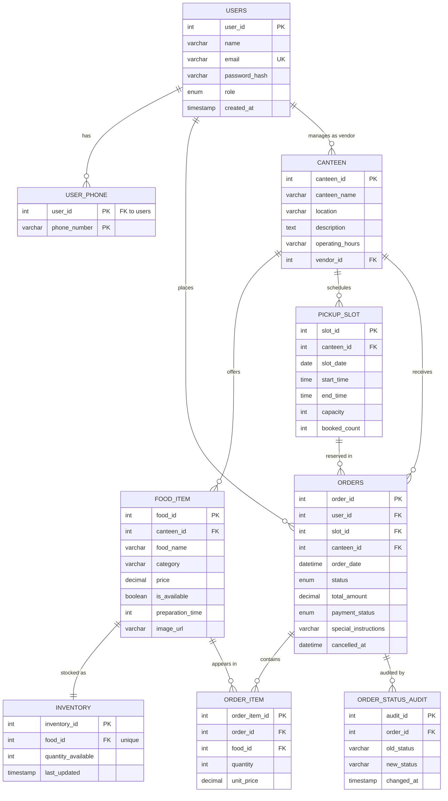

# 2. Database Design

This design **extends the Lab 4 foundation** (8 tables + the `available_pickup_slots`
view + indexes). Additions for the application are called out in §2.6.

## 2.1 ER Diagram



## 2.2 Relational Schema (text form)
```
users(user_id PK, name, email UK, password_hash, role, created_at)
user_phone(user_id PK FK→users, phone_number PK)
canteen(canteen_id PK, canteen_name, location, description, operating_hours, vendor_id FK→users)
food_item(food_id PK, canteen_id FK→canteen, food_name, category, price, is_available, preparation_time, image_url)
pickup_slot(slot_id PK, canteen_id FK→canteen, slot_date, start_time, end_time, capacity, booked_count)
orders(order_id PK, user_id FK→users, slot_id FK→pickup_slot, canteen_id FK→canteen,
       order_date, status, total_amount, payment_status, special_instructions, cancelled_at)
order_item(order_item_id PK, order_id FK→orders, food_id FK→food_item, quantity, unit_price, UK(order_id,food_id))
inventory(inventory_id PK, food_id FK→food_item UK, quantity_available, last_updated)
order_status_audit(audit_id PK, order_id FK→orders, old_status, new_status, changed_at)
```

## 2.3 Relationship Cardinalities
| Relationship | Cardinality | Notes |
|---|---|---|
| users → user_phone | 1 : N | a user may have several phone numbers |
| users (vendor) → canteen | 1 : N | a vendor manages one or more canteens |
| canteen → food_item | 1 : N | FK `ON DELETE CASCADE` |
| canteen → pickup_slot | 1 : N | FK `ON DELETE CASCADE` |
| food_item → inventory | 1 : 1 | `food_id` is UNIQUE in inventory |
| canteen / pickup_slot / users → orders | 1 : N | FK `RESTRICT` (protects history) |
| orders → order_item | 1 : N | FK `ON DELETE CASCADE` |
| food_item → order_item | 1 : N | FK `RESTRICT` |
| orders → order_status_audit | 1 : N | written by trigger |

## 2.4 Data Dictionary
**users** — accounts for all roles. `email` UNIQUE; `role ∈ {STUDENT, VENDOR, ADMIN}` (default STUDENT); `password_hash` is a bcrypt hash.
**user_phone** — multivalued phone attribute kept in its own table (1NF). Composite PK `(user_id, phone_number)`.
**canteen** — a food outlet. `vendor_id` links the managing vendor (`ON DELETE SET NULL`).
**food_item** — a menu item. `price DECIMAL(10,2) CHECK ≥ 0`; `is_available` toggles visibility; `preparation_time` minutes; `image_url` for the UI.
**pickup_slot** — a bookable time window. `CHECK capacity > 0`, `CHECK end_time > start_time`, `CHECK 0 ≤ booked_count ≤ capacity` (overbooking is structurally impossible).
**orders** — one order. `status ∈ {PLACED, PREPARING, READY, COLLECTED, CANCELLED}`; `total_amount CHECK ≥ 0`; `canteen_id` denormalised from the slot for fast per-vendor queries.
**order_item** — order line. `CHECK quantity > 0`, `CHECK unit_price ≥ 0`, `UNIQUE(order_id, food_id)`. `unit_price` snapshots the price at order time.
**inventory** — current stock per food item. `CHECK quantity_available ≥ 0` is the hard floor that prevents overselling.
**order_status_audit** — append-only log of status changes, written by the trigger.

## 2.5 Normalization (up to 3NF)
- **1NF:** all attributes atomic; the repeating "phone" attribute is factored into `user_phone`.
- **2NF:** every non-key attribute depends on the whole key. In `order_item`, `quantity`/`unit_price` depend on the full line identity; there are no partial dependencies on composite keys.
- **3NF:** no transitive dependencies. Prices live once in `food_item`; `order_item.unit_price` is an intentional historical snapshot (price at purchase), not a redundancy of the current price. `canteen_id` on `orders` is a controlled denormalization for query performance; it is always consistent because it equals the slot's canteen and is enforced in the order-placement transaction.

## 2.6 Extensions beyond Lab 4
| Object | Change | Reason |
|---|---|---|
| `food_item` | + `preparation_time`, `image_url` | present in the Lab 4 ER diagram; needed for the UI |
| `orders` | + `special_instructions`, `cancelled_at` | from ER diagram + cancellation workflow |
| `canteen` | + `vendor_id` | enforce "a vendor edits only their own canteen" |
| `orders` | + `canteen_id` | O(1) per-vendor order queries |
| `pickup_slot` | + `booked_count` | O(1), lockable capacity counter |
| new | `order_status_audit` | target of the audit trigger |

## 2.7 Why MySQL + MongoDB (database-choice justification)
**MySQL is the authoritative, transactional source of truth.** Orders, inventory,
slot capacity and money are strongly related, need multi-row ACID transactions,
foreign-key integrity and CHECK constraints — exactly what a relational engine with
InnoDB row-locking provides. Overbooking and overselling prevention *requires*
transactions + constraints, so this data belongs in SQL.

**MongoDB handles high-volume, schema-flexible, append-mostly data** that does not need
cross-entity transactions:
- `order_activity_logs` — an event stream (one document per status change / lifecycle event). Append-heavy, read as a timeline, naturally document-shaped.
- `feedback` — student ratings/comments with an optional free-text body and evolving fields; analytics are computed with an **aggregation pipeline** (average rating + count per canteen), which MongoDB expresses directly.

This keeps a **clear boundary**: MySQL owns correctness-critical state; MongoDB owns
logs and analytics. No data is duplicated across both, and there are no distributed
transactions. A **vector database is not used** — the data is structured and
transactional, not unstructured/semantic — so under the SQL + NoSQL option, vector
search is correctly marked *Not Applicable* (see the Level 3 checklist).

## 2.8 MongoDB Data Model
```
order_activity_logs {
  order_id: int, student_id: int|null, event_type: string,
  previous_status: string|null, new_status: string|null,
  timestamp: date, description: string|null
}
  indexes: {order_id:1, timestamp:-1}, {event_type:1}, {student_id:1}

feedback {
  student_id: int, order_id: int|null, canteen_id: int,
  rating: int(1..5), comment: string|null, timestamp: date
}
  indexes: {canteen_id:1, timestamp:-1}, {order_id:1}, {student_id:1}
```
Both collections use a `$jsonSchema` validator (see `db/mongo-init.mjs`). The required
aggregation pipeline (per-canteen average rating + count, sorted) powers the vendor
feedback analytics page.
