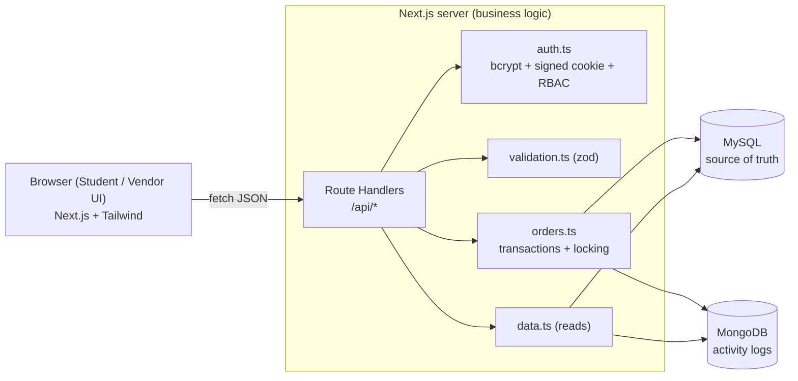

# 4. System Architecture & API

## 4.1 Architecture

- **MySQL** is authoritative for orders, inventory, slot capacity and money.
- **MongoDB** stores activity logs + feedback and computes feedback analytics.
- Activity logging happens **after commit** and is best-effort, so a logging outage
  can never roll back a real order.

## 4.2 Validation (three layers)
| Layer | Example |
|---|---|
| Frontend | required fields, min length, numeric bounds, slot must be chosen |
| Backend (zod) | `registerSchema`, `placeOrderSchema`, quantity ≤ 50, rating 1–5 |
| Database | `CHECK` (price ≥ 0, qty > 0, stock ≥ 0, booked ≤ capacity), FK, UNIQUE, ENUM |

## 4.3 Authentication & Authorization
- Passwords hashed with bcrypt. Session = a signed (HMAC-SHA256), HTTP-only cookie
  carrying `{user_id, role}`; the signature prevents tampering.
- `requireUser()` / `requireRole("VENDOR")` guard every protected route handler.
- Students cannot reach vendor APIs (403); a vendor can only manage **their own**
  canteen's food, inventory and orders (checked via `canteen.vendor_id`).

## 4.4 API Reference
| Method | Route | Role | Purpose |
|---|---|---|---|
| POST | `/api/auth/register` | public | Student self-registration |
| POST | `/api/auth/login` | public | Log in, set session |
| POST | `/api/auth/logout` | any | Clear session |
| GET | `/api/auth/me` | any | Current session user |
| GET | `/api/canteens` | any | List canteens |
| GET | `/api/menu?canteen_id&q&category&available` | any | Menu + categories (search/filter) |
| GET | `/api/slots?canteen_id&date` | student | Available slots (stored procedure) |
| POST | `/api/orders` | student | **Place order (transaction)** |
| GET | `/api/orders` | student | Order history |
| GET | `/api/orders/[id]` | owner/vendor | Order detail |
| POST | `/api/orders/[id]/cancel` | owner | **Cancel (transaction)** |
| POST | `/api/feedback` | student | Submit rating (MongoDB) |
| GET | `/api/student/dashboard` | student | Student stats |
| GET | `/api/vendor/dashboard` | vendor | Daily stats + low stock + avg rating |
| GET | `/api/vendor/canteens` | vendor | Vendor's canteens |
| GET/POST | `/api/vendor/food` | vendor | List / add food (+ inventory row) |
| PATCH/DELETE | `/api/vendor/food/[id]` | vendor | Edit / delete food |
| PATCH | `/api/vendor/inventory/[foodId]` | vendor | Set stock |
| GET | `/api/vendor/orders?status` | vendor | Incoming orders |
| PATCH | `/api/vendor/orders/[id]/status` | vendor | **Advance status (+ trigger audit)** |
| GET | `/api/vendor/feedback` | vendor | Feedback analytics (aggregation) + comments |

## 4.5 Screens
See [`screenshots/`](screenshots/): landing, student ordering, order tracking,
vendor dashboard, vendor orders, menu & stock, feedback analytics.
